# Awesome-AI-Search-Engine-Semantic-Code-Search

  

  
  
  
  
  
  

---

## 🌟 Top AI Search Engine & Semantic Code Search Ecosystem

> **A comprehensive, SEO-optimized curated catalog of cutting-edge AI Search Engines, Semantic Code Search platforms, AST/LSP Code Intelligence, Neural Metasearch, and Agentic Web Retrieval tools.**

Whether you are architecting sovereign RAG pipelines, building autonomous coding agents, indexing multi-million-line enterprise repositories, or orchestrating citation-backed conversational web research, this guide tracks the industry-leading **SaaS platforms** and **open-source (OSS) repositories** shaping modern knowledge retrieval in 2026.

### 🎯 Key Search & Indexing Domains Covered
- 🔍 **AI Answer & Deep-Research Engines**: Real-time multi-step web search synthesis with verified source citations.
- 💻 **Semantic Codebase Indexing**: Vector embeddings, Merkle-tree context indexing, and hybrid lexical-semantic code search.
- 🌲 **AST & LSP Symbol Intelligence**: Language Server Protocol graphs and Abstract Syntax Tree navigators for coding agents.
- 🌐 **Agentic Web Scraping & Search APIs**: Fast, token-efficient markdown extraction and search APIs for autonomous AI agents.
- 🛡️ **Self-Hosted Sovereign Search**: Private, local, and air-gapped metasearch engines ensuring zero telemetry and complete privacy.

---

## 📑 Table of Contents

- [📊 Sector Overview & Market Dynamics](#-sector-overview--market-dynamics)
- [🏢 SaaS/Hosted Platforms](#-saashosted-platforms)
- [🔓 Open-Source GitHub Projects](#-open-source-github-projects)
- [📈 Star History](#-star-history)
- [🤝 How to Contribute](#-how-to-contribute)
- [💖 Support & Sponsorship](#-support--sponsorship)
- [⚖️ Disclaimer](#-disclaimer)

---

## 📊 Sector Overview & Market Dynamics

The global market for AI-driven search, enterprise workplace discovery, and semantic code intelligence is estimated at approximately **$6.5B to $9.2B in 2026**, projected to exceed **$32B by 2032** at an accelerating 30%+ CAGR. 

Market dynamics reflect **moderate fragmentation with emergent "winner-takes-most" consolidation** across core sub-layers: 
- **Developer IDE Context Engines & Code Intelligence**: Experiencing aggressive tier-one concentration around dominant players (e.g., Cursor in AI-native code editing, Sourcegraph in multi-repo indexing).
- **Conversational Web Search**: Dominated by high-momentum category anchors like Perplexity AI and frontier research engines.
- **Enterprise Workplace Discovery & Agentic APIs**: Highly fragmented and intensely contested, with specialized contenders (Glean, Exa, Tavily, Firecrawl) addressing distinct enterprise permissions, agent crawling requirements, and private RAG architectures.

---

## 🏢 SaaS/Hosted Platforms

| Platform | 🏢 Company Scale (Valuation / Revenue) | 💳 Pricing (Starting Paid Tier) | 🎁 Free Tier Limits / Free Trial | 📝 Description |
| :--- | :--- | :--- | :--- | :--- |
| **[Cursor](https://cursor.com)** | **$29.3B Valuation** (~$1B+ ARR) | **$20/user/month** (Pro plan) | **Permanent Free Tier (Hobby)**: 2-week Pro trial upon signup; perpetual free plan includes 2,000 completions/month, basic agent/codebase queries, and standard (slow-queue) frontier model requests during peak hours. | 🧠 AI-native code editor featuring automatic Merkle-tree-synced semantic vector indexing (`@Codebase`) for instant natural-language search across large repositories. |
| **[Perplexity AI](https://perplexity.ai)** | **$20.0B Valuation** (~$200M–$450M ARR) | **$20/month** ($17/month billed annually for Pro) | **Permanent Free Tier**: Unlimited standard quick searches with citations; up to 3 Pro (multi-step reasoning) searches per day; 1 Deep Research report per month; file upload capped at rolling weekly limits (max 40 MB/file). | ⚡ Flagship conversational AI search and answer engine combining real-time web indexing, multi-model reasoning, Deep Research reports, and inline source citations. |
| **[Glean](https://glean.com)** | **$7.2B Valuation** (~$300M ARR) | **$45/user/month** (Enterprise contracts typically start at ~$30,000+/year with 100-seat minimums) | **No Free Tier / No Self-Serve Free Trial**: Evaluation is available exclusively via scheduled sales demos and negotiated enterprise Proof-of-Concept (POC) engagements. | 🏢 Enterprise AI workplace search and knowledge discovery platform connecting 100+ SaaS apps, code repositories, and docs with permissions-aware semantic retrieval. |
| **[Sourcegraph Cody](https://sourcegraph.com)** | **$2.6B Valuation** (~$32M–$50M ARR) | **$19/user/month** (Enterprise Cody starting tier; custom deployment contracts) | **No Permanent Free Tier**: Cody standalone free tiers were retired in mid-2025; access is provided via enterprise team trials (14 to 30 days) arranged through enterprise sales. | 🔎 Enterprise code intelligence and semantic search platform indexing massive multi-repository codebases to power context-aware chat, symbol navigation, and batch refactoring. |
| **[Exa (formerly Metaphor)](https://exa.ai)** | **$2.2B Valuation** (~$100M ARR) | **$4 per 1,000 searches** (Lite) / **$7 per 1,000 searches** (Auto/Fast); Websets plans start at **$49/month** | **Permanent Free Tier**: **$10 in free API credits every month** (~2,500 Lite searches or ~1,400 Auto searches) with a one-time $10 onboarding bonus; rate-limited at 10 QPS; no credit card required. | 🌐 Neural search engine API built with custom embedding models to retrieve semantically relevant web pages, research papers, GitHub repos, and structured entities for AI agents. |
| **[You.com](https://you.com)** | **$1.5B Valuation** | **$20/month** (Pro plan); API starts at **$5 per 1,000 queries** | **Permanent Free Tier**: Web app includes basic search queries; API provides **100 free search calls per day** without requiring a credit card. | 🤖 AI search engine and search API infrastructure for agents combining live web retrieval, multi-model reasoning, and clean markdown extraction. |
| **[Augment Code](https://augmentcode.com)** | **$977M Valuation** (~$20M ARR) | **$20/month** (Standard plan; shared credit pool architecture) | **No Permanent Free Tier**: Offers a **14-day free trial** for evaluation; subsequent access requires a paid monthly workspace subscription or enterprise POC. | 🚀 Enterprise AI software engineering platform built around a real-time semantic context engine capable of indexing and reasoning across multi-million-line monorepos. |
| **[Greptile](https://greptile.com)** | **$750M Valuation** (Series B) | **$1 per credit** (Pro plan; no per-seat fees, pooled across team) | **Permanent Free Tier (Starter)**: **50 free credits per month** for 1 developer across unlimited repositories; 14-day free trial for Pro team tier; free for open-source maintainers. | 🤖 AI codebase indexing and semantic code search API/bot enabling teams and agents to query entire repositories, understand cross-file dependencies, and automate PR reviews. |
| **[Tavily](https://tavily.com)** | **$275M Acquisition** (by Nebius) | **$30/month** (Project plan, includes 4,000 credits; $0.008/credit overage) | **Permanent Free Tier (Researcher)**: **1,000 API credits per month** (1 search = 1 credit; extract = 1 credit per 5 URLs); capped at 100 requests per minute; no credit card required. | ⚡ AI-native search engine API engineered specifically for LLM agents and RAG pipelines, returning clean, ranked, snippet-extracted web context optimized for minimal token overhead. |
| **[Kapa.ai](https://kapa.ai)** | **~$15M–$25M Est. Valuation** (~$1.2M ARR) | **$299/month** (Growth plan; custom quotes for high volume) | **14-Day Free Trial**: Full access for 14 days capped at 1 knowledge index, up to 5,000 crawled pages, 5,000 retrieval queries, and 1,000 generated answers; free program for open-source projects. | 📚 AI technical documentation and developer support search platform indexing docs, GitHub issues, Discord threads, and codebases into cited developer Q&A assistants. |

---

## 🔓 Open-Source GitHub Projects

*Sorted by GitHub Stars_Count (descending)*

- **[Firecrawl (`mendableai/firecrawl`)](https://github.com/mendableai/firecrawl)**   
  🔥 Turn entire websites into clean, LLM-ready markdown or structured data with crawl, scrape, map, and extract endpoints built specifically for AI search engines and agents.

- **[RAGFlow (`infiniflow/ragflow`)](https://github.com/infiniflow/ragflow)**   
  🌊 Open-source RAG engine based on deep document understanding and multi-modal semantic search, synthesizing grounded answers with complete citations across complex enterprise corpora.

- **[Crawl4AI (`unclecode/crawl4ai`)](https://github.com/unclecode/crawl4ai)**   
  🕷️ Open-source, lightning-fast web crawler and scraper tailored for LLMs and AI pipelines, outputting structured Markdown, chunks, and citations with minimal latency.

- **[ripgrep (`BurntSushi/ripgrep`)](https://github.com/BurntSushi/ripgrep)**   
  ⚡ Blazingly fast line-oriented regex search tool respecting gitignore patterns, widely embedded in AI coding agents and local codebase indexers as the lexical retrieval backbone.

- **[Meilisearch (`meilisearch/meilisearch`)](https://github.com/meilisearch/meilisearch)**   
  🦀 Lightning-fast, Rust-based open-source search engine providing typo-tolerant full-text search and hybrid semantic search vector capabilities via an intuitive RESTful API.

- **[LibreChat (`danny-avila/LibreChat`)](https://github.com/danny-avila/LibreChat)**   
  💬 Enhanced open-source AI platform featuring multi-model orchestration, integrated web search (SearXNG/Google/Bing/Tavily), file retrieval, and agents with source citations.

- **[SearXNG (`searxng/searxng`)](https://github.com/searxng/searxng)**   
  🛡️ Privacy-respecting open-source metasearch engine aggregating results from 70+ search services with JSON API output—widely deployed as the default self-hosted web-search backend for AI agents.

- **[Perplexica (`ItzCrazyKns/Perplexica`)](https://github.com/ItzCrazyKns/Perplexica)**   
  🔮 Self-hosted AI search engine alternative to Perplexity AI powered by SearXNG and local (Ollama) or cloud LLMs, featuring specialized Focus Modes and cited references.

- **[Khoj (`khoj-ai/khoj`)](https://github.com/khoj-ai/khoj)**   
  🧠 Open-source AI second brain and self-hosted search engine that indexes personal notes, documents, PDFs, GitHub code, and web content with citation-backed semantic retrieval.

- **[Continue (`continuedev/continue`)](https://github.com/continuedev/continue)**   
  💻 Leading open-source AI code assistant for VS Code and JetBrains featuring an embedded codebase indexer (`@codebase`) combining Tree-sitter AST chunking and LanceDB vector search.

- **[Qdrant (`qdrant/qdrant`)](https://github.com/qdrant/qdrant)**   
  🎯 High-performance open-source vector search engine and database written in Rust with extended filtering and hybrid search support, ideal for production semantic search backends.

- **[Tabby (`tabbyML/tabby`)](https://github.com/tabbyML/tabby)**   
  🐱 Self-hosted AI coding assistant with built-in repository context indexing, AST parsing, and code search engine powering privacy-first code completion and inline navigation.

- **[Onyx (`onyx-dot-app/onyx`, formerly Danswer)](https://github.com/onyx-dot-app/onyx)**   
  💎 Enterprise open-source AI workplace search platform connecting 40+ workplace data sources (GitHub, Confluence, Slack, Google Drive) with hybrid semantic retrieval and verified citations.

- **[STORM (`stanford-oval/storm`)](https://github.com/stanford-oval/storm)**   
  🌪️ Open-source knowledge curation and research engine from Stanford NLP that conducts multi-perspective search queries to generate grounded, cited long-form analytical articles.

- **[Serena (`oraios/serena`)](https://github.com/oraios/serena)**   
  🧩 Semantic coding-agent toolkit and MCP server leveraging Language Server Protocol (LSP) symbol graphs to provide AI agents with precise `find_symbol` and `find_referencing_symbols` search.

- **[GPT-Researcher (`assafelovic/gpt-researcher`)](https://github.com/assafelovic/gpt-researcher)**   
  🔬 Autonomous open-source deep-research agent conducting parallelized web and local document searches to compile detailed, citation-backed research reports.

- **[Tree-sitter (`tree-sitter/tree-sitter`)](https://github.com/tree-sitter/tree-sitter)**   
  🌳 Foundational incremental parsing library powering syntax-aware code chunking, repository symbol maps, and structural AST extraction across 100+ programming languages.

- **[SurfSense (`MODSetter/SurfSense`)](https://github.com/MODSetter/SurfSense)**   
  🏄 Open-source alternative to NotebookLM and Perplexity connecting personal knowledge bases (Slack, Notion, GitHub, YouTube, PDFs) with hybrid semantic + keyword search.

- **[ast-grep (`ast-grep/ast-grep`)](https://github.com/ast-grep/ast-grep)**   
  🌲 Fast structural Abstract Syntax Tree (AST) code search and rewriting tool used by coding agents to query syntactic code patterns across large codebases.

- **[CocoIndex (`cocoindex-io/cocoindex`)](https://github.com/cocoindex-io/cocoindex)**   
  🥥 High-speed data and semantic code indexing framework written in Rust featuring incremental Tree-sitter code chunking and real-time vector sync.

- **[Bloop (`BloopAI/bloop`)](https://github.com/BloopAI/bloop)**   
  🔎 Fast code search engine using Tree-sitter, Rust, and semantic vector embeddings to search codebases using natural language and regex queries.

- **[Morphic (`miurla/morphic`)](https://github.com/miurla/morphic)**   
  ✨ Open-source AI-powered search engine with a generative UI built on Next.js, supporting multi-provider LLMs, SearXNG/Tavily search, and chat history persistence.

- **[OpenGrok (`oracle/opengrok`)](https://github.com/oracle/opengrok)**   
  🏛️ Battle-tested source code search and cross-reference engine supporting full-text, symbol, definition, and version-history indexing across massive repositories.

- **[Farfalle (`rashadphz/farfalle`)](https://github.com/rashadphz/farfalle)**   
  🦋 Lightweight self-hosted AI search engine UI supporting local and cloud LLMs (Ollama, OpenAI, Groq) with SearXNG and Tavily web retrieval.

- **[Zoekt (`sourcegraph/zoekt`)](https://github.com/sourcegraph/zoekt)**   
  ⚡ Fast trigram-based code search engine engineered by Sourcegraph for sub-second regex, symbol, and multi-repository code search at scale.

- **[Code-Index-MCP (`johnhuang316/code-index-mcp`)](https://github.com/johnhuang316/code-index-mcp)**   
  🔌 Open-source Model Context Protocol (MCP) server providing AI coding assistants with persistent, semantic, and AST-indexed codebase search.

- **[h100envy/gem-search (`h100envy/gem-search`)](https://github.com/h100envy/gem-search)**   
  💎 Open-source AI-powered search engine and grounded answer utility built for fast web retrieval, semantic synthesis, and streamlined search workflows.

---

## 📈 Star History

---

## 🤝 How to Contribute

Contributions are warmly welcomed! Help keep this ecosystem comprehensive, accurate, and up to date:

1. 🍴 **Fork the repo**.
2. 🌿 **Create a feature branch** (`git checkout -b feature/add-new-search-tool`).
3. 📝 **Add/edit entries in `README.md`**:
   - Follow the existing table/list formatting conventions.
   - For SaaS products, supply specific starting tier pricing and exact free tier limits.
   - For open-source repos, include the social-style Stars_Badge linked to `/stargazers`.
4. 🚀 **Submit a Pull Request** with a concise description of your changes.

---

## 💖 Support & Sponsorship

Thank you so much for exploring and using this curated ecosystem! If this repository has saved you engineering time, helped you evaluate search architectures, or inspired your agentic AI workflows, please consider showing your support:

- ⭐ **Star this repository** to help others discover it on GitHub.
- 🍴 **Fork and share** it with your developer community, colleagues, and AI research teams.
- ☕ **Buy me a coffee / Sponsor the project**: Contributions directly fuel continued curation, benchmark analysis, and active maintenance. You can sponsor via the **[GitHub Sponsors Dashboard](https://github.com/sponsors/ishandutta2007)**.

Your support is deeply appreciated! 🙌

---

## ⚖️ Disclaimer

All product names, logos, brands, and registered trademarks belong to their respective owners. Company, product, and service names used in this repository are for identification, indexing, and research purposes only. Mention in this repository does not imply endorsement or official affiliation.
